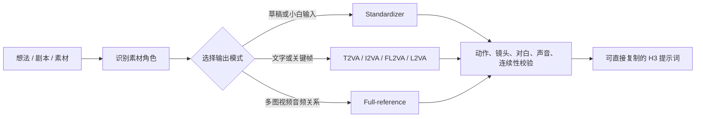

# MiniMax H3 Studio

> 一个统一、可直接复用的 MiniMax H3 提示词 Skill：从一句想法到可生成的音画提示词，从单图关键帧到多图 / 视频 / 音频参考，一套入口完成判断、整理、分段与校验。

[](https://www.minimaxi.com/)
[](https://github.com/openai/codex)
[](#支持的模式)

## 这是什么

MiniMax H3 Studio 把三类原本分开的工作合成一个统一工作流：

- **规范化模式**：把一句话、草稿、故事、对白或广告概念整理成适合直接生成的中文提示词。
- **文生 / 关键帧模式**：输出原生英文三字段模板，支持 T2VA、I2VA、FL2VA、L2VA。
- **多参考模式**：输出六字段英文模板，处理角色、场景、视频、音频、主体替换、续写和音频复用。

它会先识别素材真正承担的角色，再选择模板；角色参考不会被误当成首帧，视频里的音轨也不会被默认当成复用音频。

## 支持的模式

| 模式 | 适用场景 | 输出 |
| --- | --- | --- |
| Standardizer | 小白输入、扩写、修复、压缩、分段 | 中文可复制提示词 |
| T2VA | 纯文字生成视频 | 三字段英文模板 |
| I2VA | 单图作为首帧 | 首帧对齐 + 三字段英文模板 |
| FL2VA | 图片作为首尾帧 | 首尾帧对齐 + 三字段英文模板 |
| L2VA | 单图作为尾帧 | 尾帧对齐 + 三字段英文模板 |
| Full-reference | 多图 / 视频 / 音频、多角色、主体替换 | 六字段英文模板 |
| Hybrid reference | 身份参考 + 具体关键帧的组合 | 明确区分 Subject / Picture 角色 |

## 快速使用

把这个目录复制到 Codex 的 skills 目录，然后直接调用：

```text
使用 $minimax-h3-studio，把这个想法整理成适合 MiniMax H3 的最佳提示词：
一个女孩在雨夜车站等人，8 秒，16:9。
```

Windows PowerShell：

```powershell
Copy-Item -Recurse . "$HOME\.codex\skills\minimax-h3-studio"
```

macOS / Linux：

```bash
cp -R . ~/.codex/skills/minimax-h3-studio
```

也可以直接指定输出格式：

```text
使用 $minimax-h3-studio，按 FL2VA 原生英文模板输出。
```

```text
使用 $minimax-h3-studio，把这三张人物图、一个动作视频和一段音频整理成六字段多参考提示词。
```

## 工作流



## 目录

```text
.
├── SKILL.md                         # 统一入口与路由规则
├── agents/openai.yaml               # Codex 界面元数据
└── references/
    ├── full-reference-guide.md      # 六字段多参考完整规范
    ├── video-prompt-guide.md        # 三字段共享镜头 / 对白 / 声音规范
    ├── standardizer-multi-reference-zh.md
    └── standardizer-text-keyframe-zh.md
```

## 设计重点

- 保留用户原始对白、歌词、屏幕文字及其语言。
- 根据素材角色建立稳定的 Subject / Picture / Video / Audio 映射。
- 把动作、镜头、空间关系、光线、口型、环境声与配乐分开描述。
- 长故事只在真实的视觉边界处分段，并为每段明确尾帧状态。
- 对身份漂移、服装变化、道具重复、轴线反转、镜头跳变、口型错位和多余文字做针对性约束。
- 不虚构未检查到的图片内容、音频文字或素材属性。

## 校验

Skill 文件可用 Codex 的技能校验脚本检查：

```bash
python -X utf8 ~/.codex/skills/.system/skill-creator/scripts/quick_validate.py .
```

## License

MIT

